# FilePilot

**Organize smarter. Find what matters.**

FilePilot is a Windows desktop utility for understanding crowded folders, reviewing exact duplicates, and organizing files with an explicit preview and reversible move history. It runs entirely on your computer.

The interface uses warm paper surfaces, charcoal typography, a forest-green identity, and native Qt-painted icons, storage visualization, and page-specific empty illustrations. Dark mode uses graphite surfaces and a softer sage accent. First launch shows an honest empty state, with no sample files loaded.

## Features

- Recursive, read-only folder scans with native folder selection, cancellation, progress, and per-path error reporting.
- Dashboard with a persistent summary strip, proportional category storage, counts and percentages, largest files, and actionable large/older/duplicate insights.
- Model-backed file table with filename search, active filter indicators, reset, numeric/date sorting, copyable full-value inspection, and **Show in Explorer**.
- Exact duplicate groups found through identical-size candidates and chunked SHA-256 hashing. Extra-copy bytes use `(copies - 1) × size`. No duplicate deletion.
- Category-based organization previews showing source → destination, conflicts, already-organized files, and an explanation of nested-file restructuring before applying.
- Explicit confirmation before moves; existing filenames are always skipped, including collisions between proposed moves.
- Persistent operation timeline with explicit undo selection, individual file outcomes, verified undo, partial undo, and retries for failed restores.
- Confirmed **Clear history** removes only terminal records with nothing left to restore; actionable and retryable operations remain. Clearing changes the local journal, never your files or folders.
- Durable move/restore intent and read-only recovery of interrupted operations on startup.
- Real preferences: selectable Light/Dark/System themes, unit-labelled review thresholds, editable category destinations, and inline save feedback.
- Browsing, filtering, and inspection remain available during background work; conflicting actions are disabled until completion.
- Keyboard shortcuts: **Ctrl+O** choose folder, **Ctrl+R** rescan, **Ctrl+F** filename search.

## Screenshots

These captures use the real Qt interface. The populated dashboard was scanned from an isolated, generated test fixture. Production launches empty.

| Light | Dark |
| --- | --- |
| 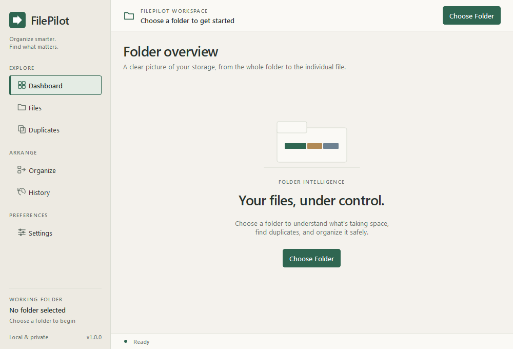 | 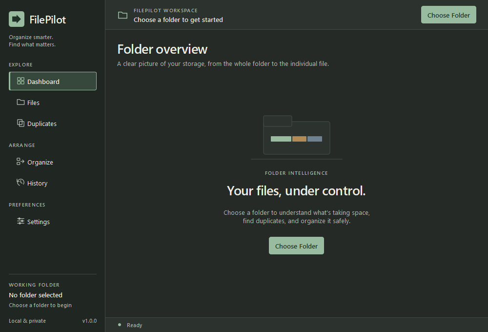 |
| 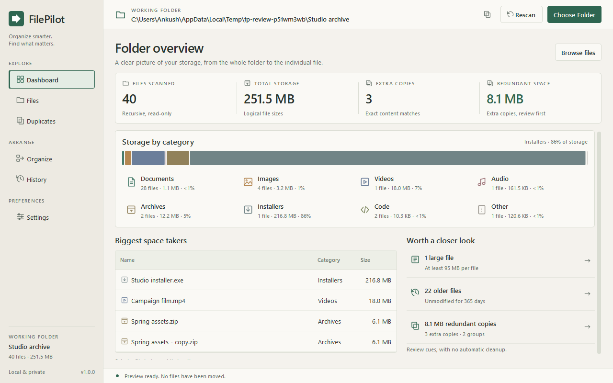 | 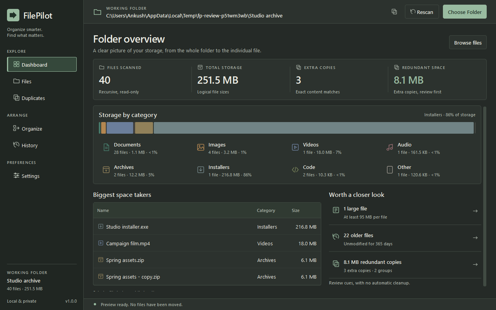 |
| 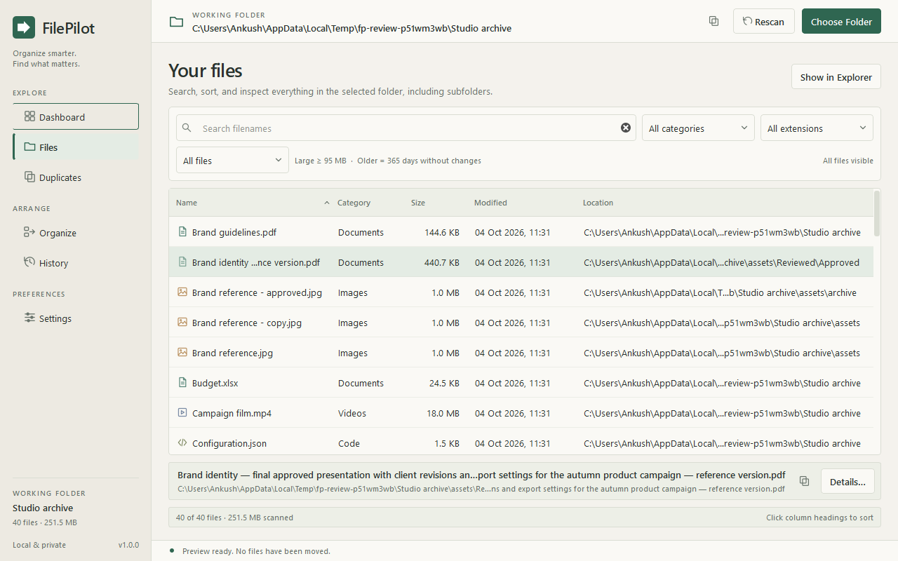 | 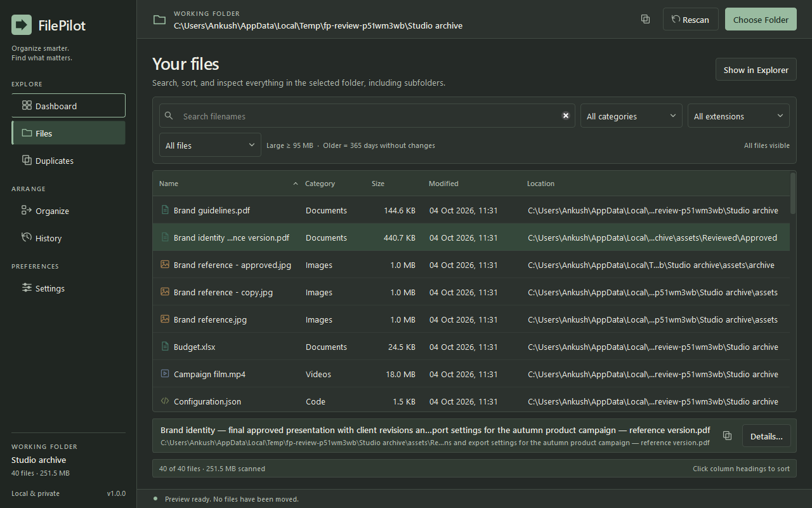 |
| 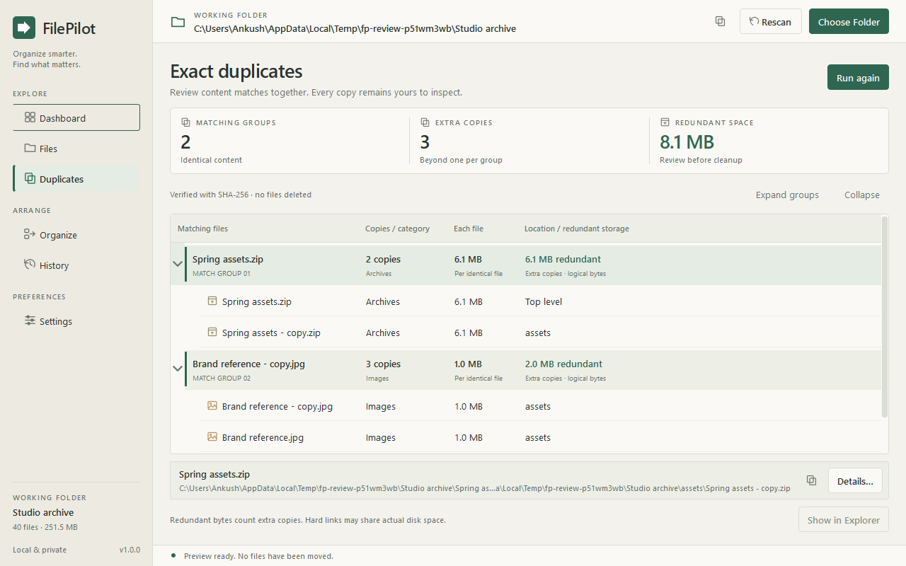 | 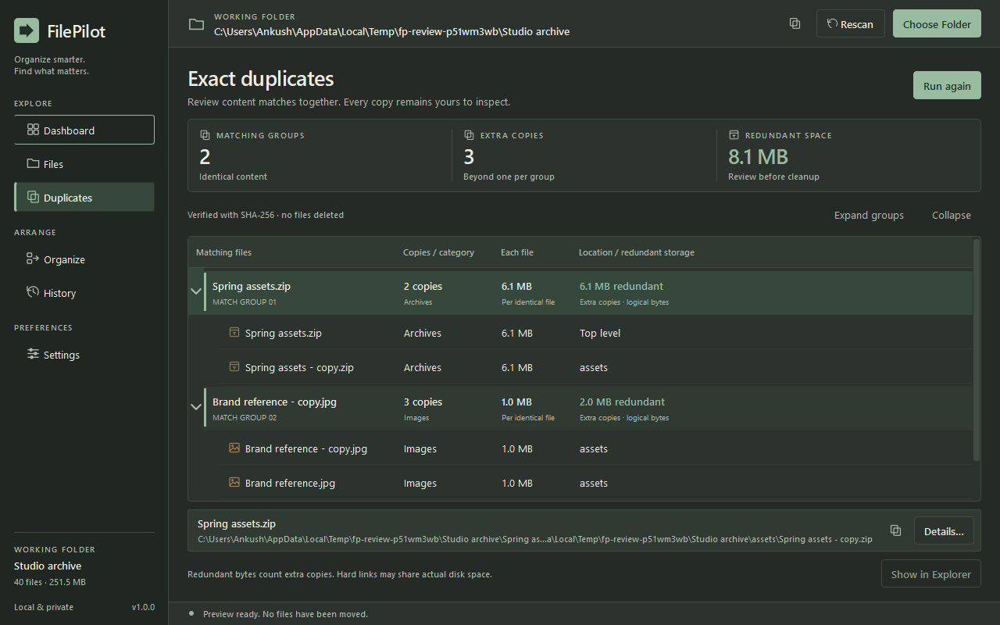 |
| 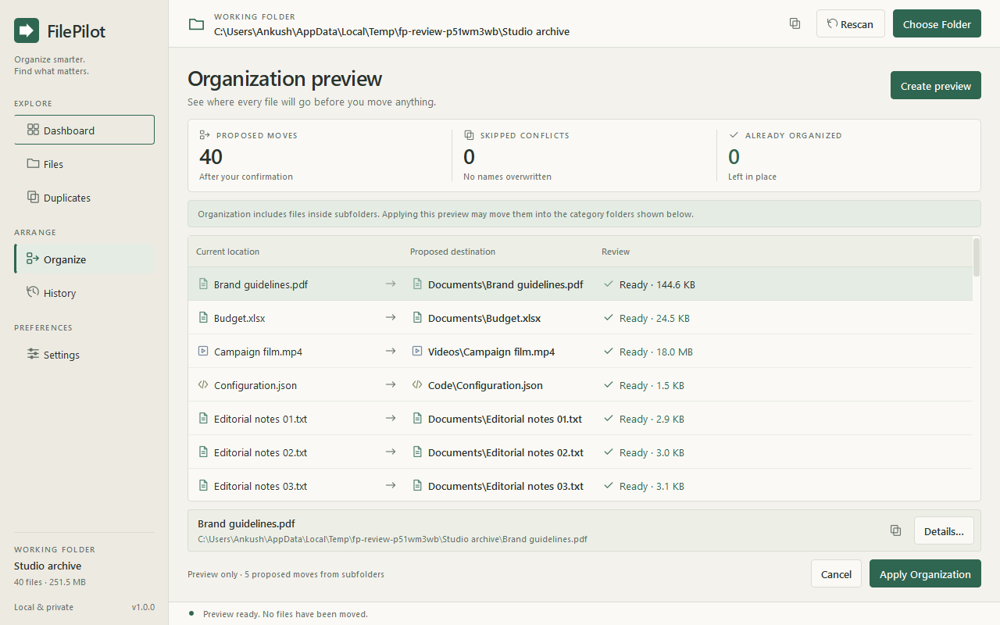 | 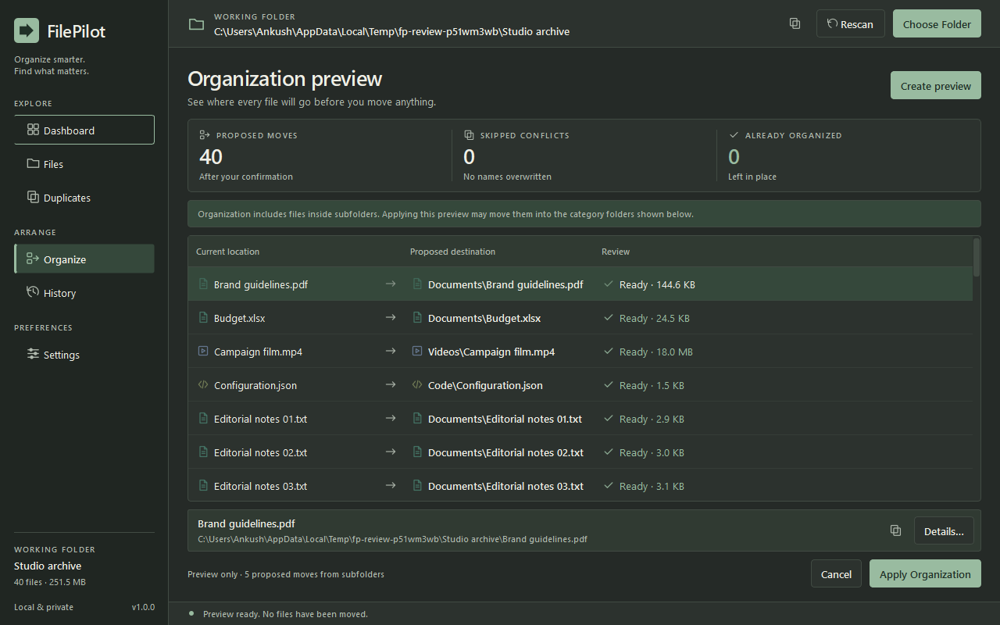 |
| 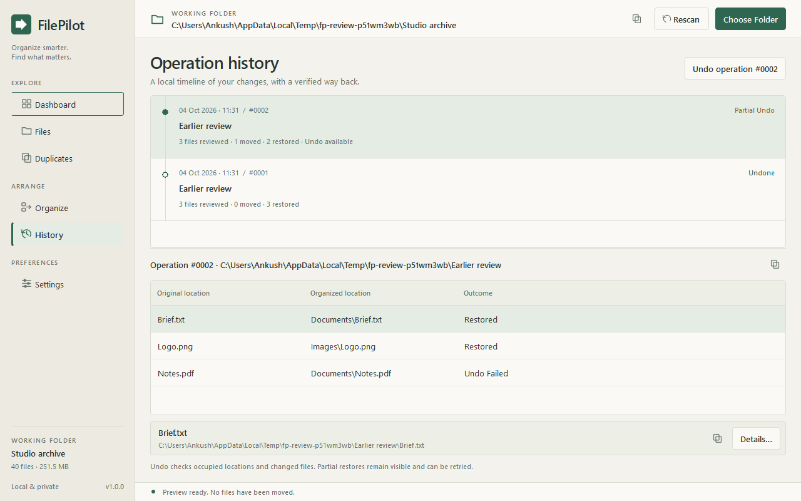 | 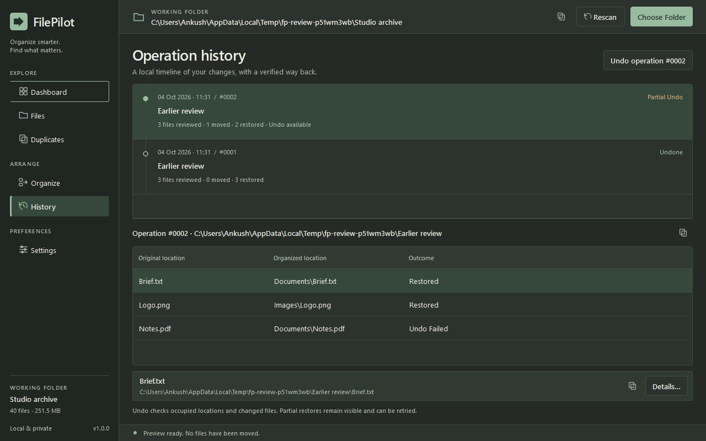 |
| 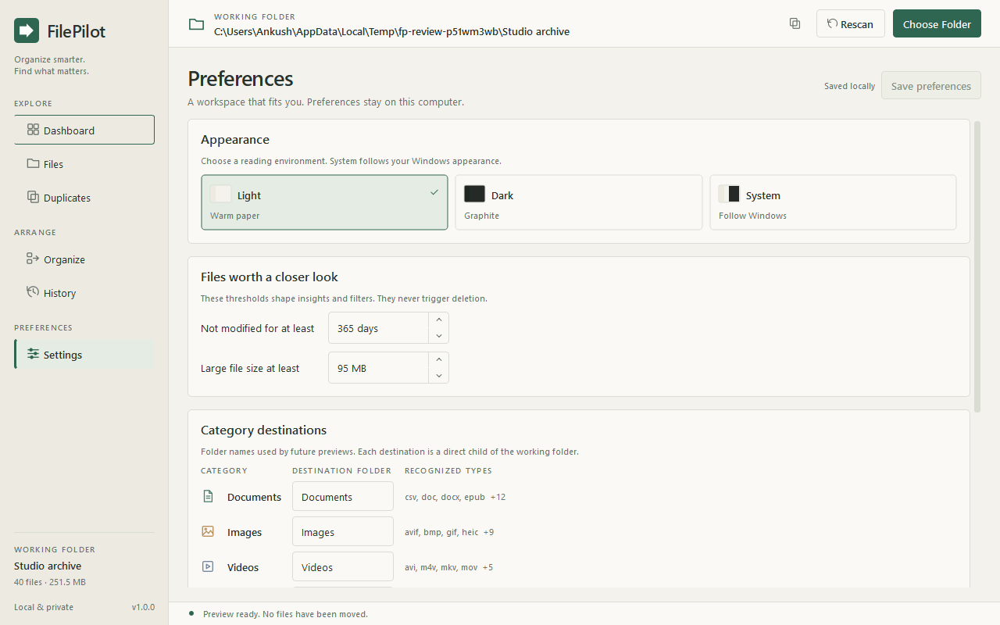 | 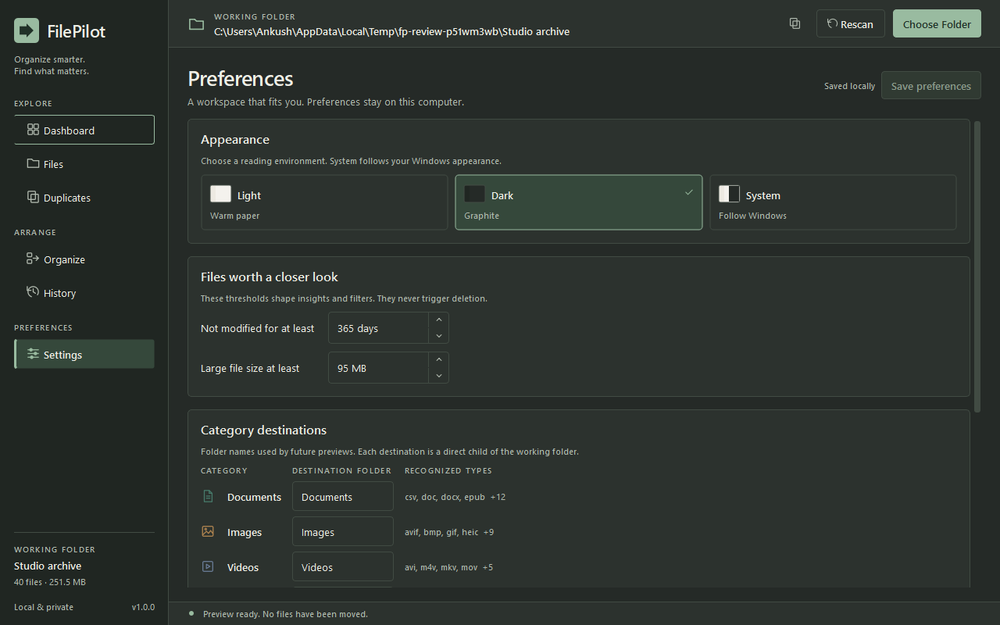 |

Portfolio captures come from the native Windows Qt platform and disposable fixtures. `python verification/refinement_ui.py` exercises all six pages in Light, Dark, and System at 1440×900, 1280×800, and 1000×680, with scroll regression checks, long-value inspection, empty/single/zero-byte cases, confirmation, background browsing, and a real partial-undo retry. Add `--native` for the Windows platform. Use `--native --current-scale` for the two smaller sizes on a 1080p display at 125% scaling; the complete native matrix was also verified at 100% scale. The original `verification/render_ui.py` remains available for the smaller baseline fixture.

## Technology

- Python 3.12+
- PySide6 / Qt 6
- SQLite, `pathlib`, `os`, `hashlib`, and other Python standard-library modules
- pytest; Qt's built-in QtTest module for UI verification

No web server, charting package, AI SDK, account, or cloud dependency is involved. Internet access is needed only to install the Python packages.

## Setup and launch

In PowerShell, from `C:\FilePilot`:

```powershell
py -3 -m venv .venv
.\.venv\Scripts\python.exe -m pip install -r requirements.txt
.\.venv\Scripts\python.exe main.py
```

The existing development environment in this workspace is already installed. Launch it directly:

```powershell
Set-Location C:\FilePilot
.\.venv\Scripts\python.exe main.py
```

You can optionally start with a read-only folder scan:

```powershell
.\.venv\Scripts\python.exe main.py --folder "C:\YourFolder"
```

For an installed CLI entry point, install the package with `python -m pip install -e .` and run `filepilot`.

## Use

1. **Choose Folder** to scan. This reads metadata and makes no changes.
2. Browse **Dashboard** and **Files**. **Duplicates → Find duplicates** compares content in a separate background operation.
3. **Organize → Create preview** proposes moves into direct category folders. Review the full paths and skipped conflicts.
4. **Apply Organization → Move files** is the only organization flow that moves files. The confirmation defaults to Cancel.
5. Select an operation in **History**. **Undo operation #… → Restore files** checks the recorded file before restoring it. Completed moves are selected explicitly; reopening History without a selection does not choose an undo target for you.
6. **History → Clear history** optionally removes fully undone or skipped-only terminal records after confirmation. Completed operations with moved files, partial restores and unresolved operations are kept. Clearing cannot be undone; it never changes working-folder contents.

After apply or undo, FilePilot refreshes the current scan. Page navigation reuses the existing scan. Cancelled scans are labelled partial, and must be rescanned to produce an organization preview. Cancelled duplicate analysis is also labelled partial.

## Safety philosophy

Scanning and preview generation are read-only. There is no file-delete action or automatic duplicate cleanup. Paths, content, and metadata are checked again at execution time; a scan is never treated as permission to move files.

- Symbolic links, Windows junctions, and other reparse points are skipped. Existing ancestors are checked before operations.
- The source application directory and FilePilot's data directory are protected from analysis and organization. Selecting the application folder itself is refused.
- Destinations must remain inside the selected root. Category names cannot include paths, Windows reserved names, or case-insensitive duplicates.
- A file already below its matching root category folder stays where it is. Other nested files are proposed for the category folder; the preview explicitly shows this flattening.
- Missing, changed, locked, and inaccessible files fail individually. A changed file needs a fresh scan.
- Windows moves use same-volume `os.rename`, which refuses an occupied destination. The portable fallback uses a no-replace hard link followed by removal of the original entry. Cross-volume moves are refused.
- Successful moves retain file identity and a SHA-256 content fingerprint. Undo refuses a replaced, modified, missing, or conflicting file. After complete file restoration, it removes only verified, empty category directories created by that operation. Preexisting, replaced, nonempty, protected, and still-referenced folders remain. Removal is never recursive; cleanup failures do not change successful restoration counts.
- SQLite commits intent before a move or restore, and records completion afterward. These are not one atomic filesystem/database transaction: startup recovery verifies where an interrupted file arrived without moving it. Ambiguous items remain visible in History for manual review.
- Cancellation stops at safe work boundaries. Successfully moved files remain journaled and can be undone.

The app is intended for normal local Windows filesystems, not as protection against another process deliberately racing or manipulating every path check. There is no filesystem watcher or lock against all external changes; review and rescan when another application is modifying the folder. History is a move journal, not a backup.

## Persistence and privacy

On Windows, the database is created automatically at:

```text
%LOCALAPPDATA%\FilePilot\filepilot.sqlite3
```

Use `--data-dir "C:\YourDevelopmentData"` to isolate development storage. Tests always use temporary databases and test-created files.

Schema version 2 contains:

| Table | Purpose |
| --- | --- |
| `operations` | Timestamp, source root, proposed item count, and operation status |
| `operation_items` | Original/destination paths, file identity, size, modification time, fingerprint, outcome, and error |
| `operation_directories` | Per-operation category paths, creation provenance, directory identity, and cleanup outcome |
| `settings` | Validated local preferences |

`PRAGMA user_version` guards schema compatibility. The additive version-1-to-2 migration preserves existing history and settings in a transaction. Older operations have no recorded directory ownership, so their folders are retained. Connections use foreign keys, WAL journaling, full synchronization, and transactions. Each service call opens its own short-lived connections so the UI and worker do not share a thread-bound SQLite connection. A database created by a newer version is refused rather than modified.

No telemetry, analytics SDK, uploads, accounts, or external APIs. Filenames, paths, operation metadata, and hashes stay local. File contents are streamed for hashing and are not stored in SQLite. Scan results live in memory and are not persisted.

## Architecture

The core does not import Qt. Typed dataclasses represent scans, file metadata, duplicate groups, plans, settings, and outcomes. Services perform scanning, analysis, hashing, preview, apply, undo, and recovery. The persistence layer stores the journal. The Qt shell owns the current scan state, native dialogs, confirmation, page navigation, and worker lifecycle. Shared UI components own the sidebar/header/status/feedback, icon and illustration family, summary and storage controls, elision/copy/details, and duplicate/preview presentation models. Themes centralize palette, typography, and native control states. The dashboard summary sits outside its scrolling viewport, preventing partially scrolled metric values.

```text
FilePilot/
├── main.py                         # Desktop entry point
├── pyproject.toml                  # Package / CLI / pytest configuration
├── requirements.txt
├── filepilot/
│   ├── main.py                     # Qt bootstrap and CLI options
│   ├── core/                       # Categories, per-user paths, safety primitives
│   ├── models/                     # Dataclasses
│   ├── database/                   # Versioned SQLite store
│   ├── services/                   # Scanner, duplicates, analysis, organizer/undo
│   └── ui/
│       ├── assets/                 # Application mark and theme-aware chevrons
│       ├── components/             # Shell, controls, details, models, custom painting
│       ├── pages/                  # Six product pages
│       ├── theme.py                # Light and dark palettes
│       ├── state.py                # Shared scan/analysis/preview state
│       ├── workers.py              # Cancellable QThread jobs
│       └── window.py               # Desktop shell and interaction coordination
├── tests/                          # Isolated core and Qt integration tests
├── assets/screenshots/             # Verified portfolio captures
├── docs/refinement-report.md       # Engineering report and changed-file inventory
└── verification/                   # Baseline/refinement captures and native startup checks
```

Scanning, duplicate hashing, preview generation, threshold analysis, apply, undo, and interruption recovery execute off the main Qt thread. File and preview tables access records through models rather than creating a widget for every row. Hashing reads one-megabyte chunks and ignores singleton size groups.

## Tests

```powershell
.\.venv\Scripts\python.exe -m pytest -q
.\.venv\Scripts\python.exe -m compileall -q filepilot main.py
.\.venv\Scripts\python.exe verification\render_ui.py
.\.venv\Scripts\python.exe verification\refinement_ui.py
.\.venv\Scripts\python.exe verification\refinement_ui.py --native --current-scale
.\.venv\Scripts\python.exe verification\startup_smoke.py
.\.venv\Scripts\python.exe verification\production_audit.py --native
.\.venv\Scripts\python.exe verification\product_polish_ui.py --native --current-scale
```

Coverage includes category classification, file-size formatting, read-only recursive scanning, missing/denied paths, protected directories, cancellation, exact duplicates, redundant-space arithmetic, organization previews, existing and planned conflicts, transaction failures, interruption recovery, changed-content undo refusal, partial undo and retry, settings, schema versioning, sorting/filtering, confirmations, background workflows, empty states, and theme/window rendering.

The Windows symlink-creation test skips when Developer Mode or symlink privileges are unavailable. A separate junction-loop test covers Windows reparse-point traversal without requiring those privileges.

Verified on Windows with Python 3.14.6, PySide6 6.11.2, and pytest 9.1.1: **149 passed, 1 skipped in 192.49s**. The skip remains the privilege-dependent symbolic-link creation test. All previous 124 passing cases are preserved, with 25 Clear History cases added. Compilation, migration tests and native startup passed. The final native review covers all six pages in all three themes and requested sizes, plus 125% scaling at the two smaller sizes, with no Qt warnings or painting/geometry failures. The native 40-file workflow restored the original file/folder snapshot, removed seven created categories, preserved the preexisting category, and cleared the completed record without changing files or folders. The 1,200-file event-loop test and focused History painting tests still pass. See [the final product-polish report](docs/product-polish-report.md) for eligibility rules, exact changes and verification evidence; [the production-readiness report](docs/production-readiness-report.md) documents the existing safe directory cleanup.

## Current limits and next steps

V1 is a source-distributed desktop application; an installer, signing, and automatic updates are future work. Organization applies all conflict-free rows in a preview; selective per-row choices and additional rule types can be added. Category mappings are centralized in code; destination folder names are editable in Settings. No duplicate deletion, filesystem monitoring, scan caching across launches, or cross-volume organization is implemented.

Reported storage is the sum of logical file sizes. Hard links, sparse files, and compression can make actual occupied disk space different. Created time is collected in scan metadata only when the platform provides it reliably; the Files table displays and sorts modification time. Content hashes identify exact matches among successfully read files, not perceptual image or semantic document similarity.

Future work can add signed Windows packaging, configurable exclusions, selective previews, disk-allocation-aware accounting, and larger-scale benchmarking without compromising the local-first design.
